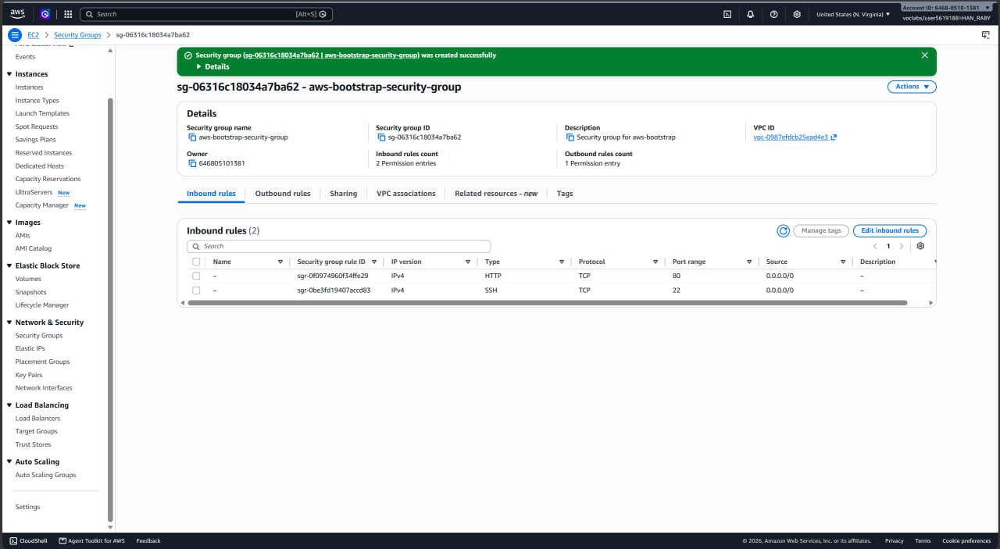
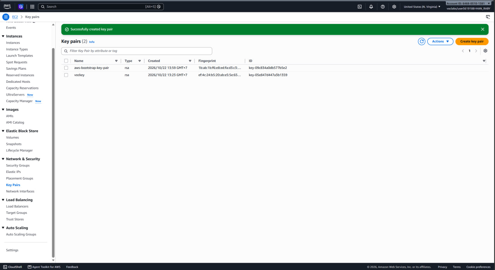
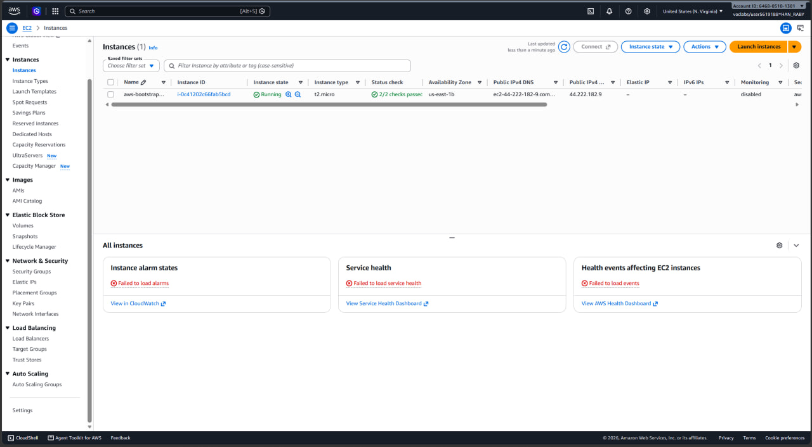
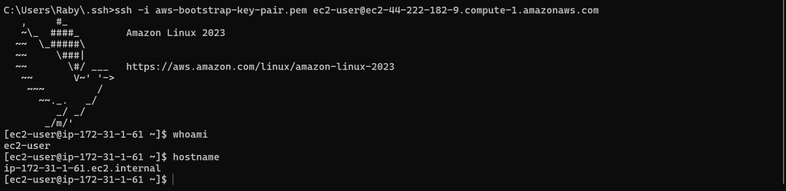
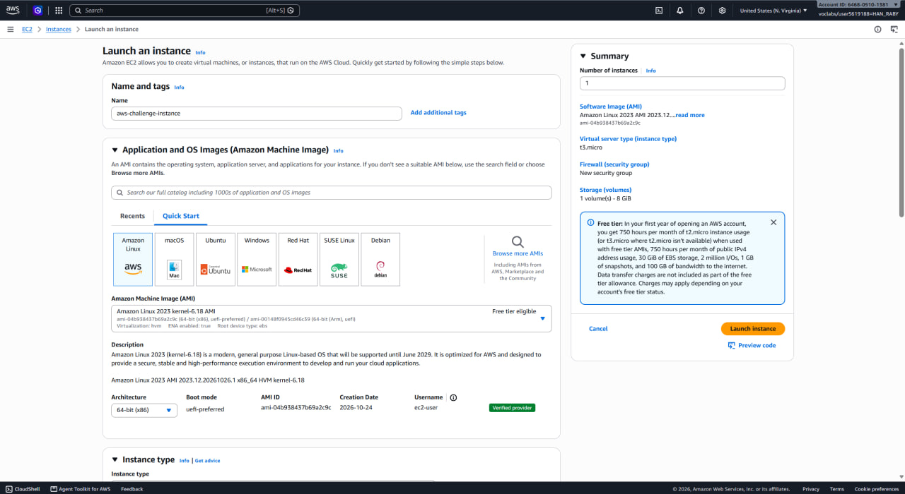
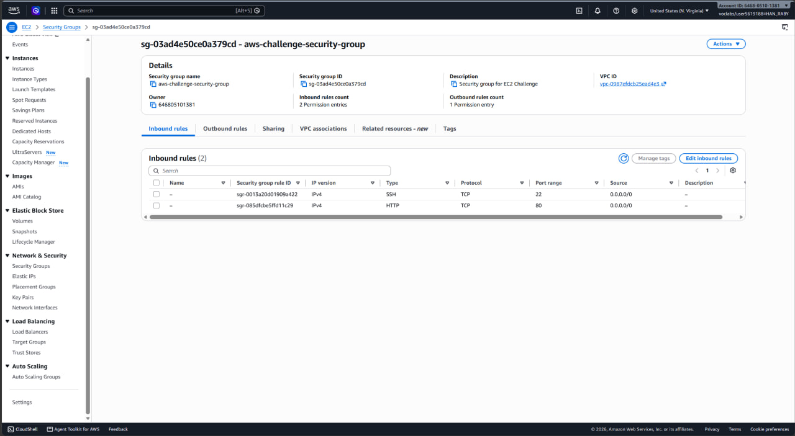
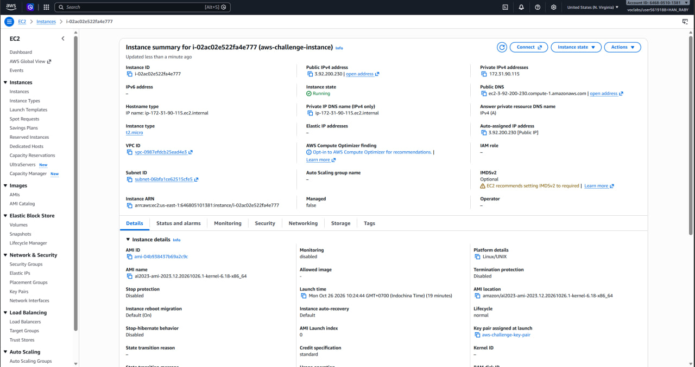
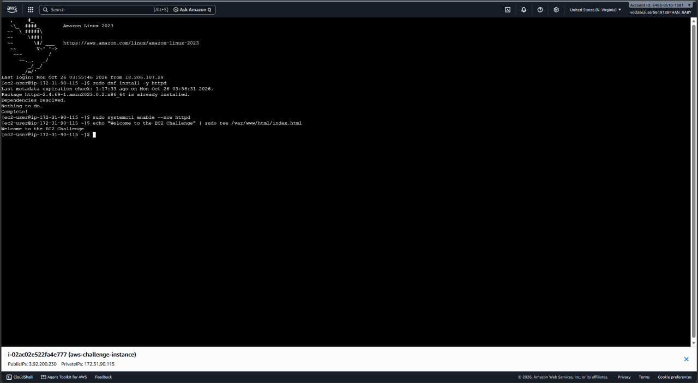
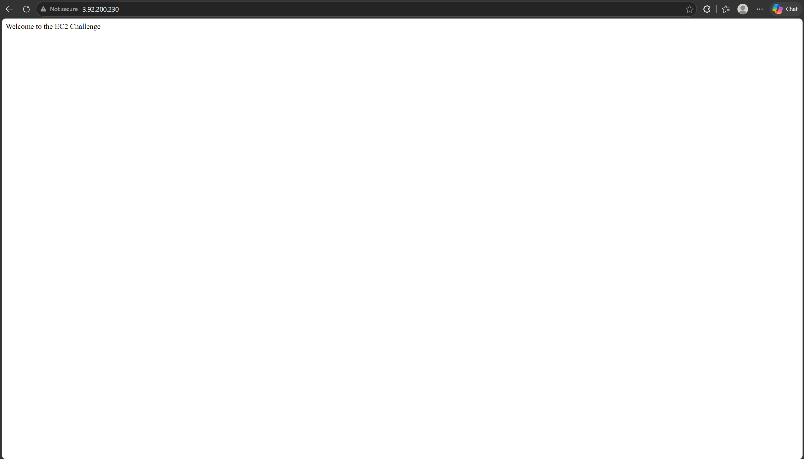

# Cloud Lab 1 Submission — Amazon EC2

Copy this template to `cc-lab-YOUR_ID/lab1/README.md` in your own repository. Follow [the instructions](lab1-instruction.md). Put your screenshots in `lab1/images/` with the file names below.

- **Student name: Han Raby**
- **Student ID: e20220580**
- **Learner Lab user name: Han Raby**
- **Date completed:**

---

## Part 1.1 — An Amazon EC2 Walkthrough

### Security group



### Key pair



### Instance details



### Browser test


### SSH connection




---

## Part 1.2 — EC2 Web Solution (Challenge)

### Launch configuration



### Security group



### Running instance



### Commands on the instance



Paste the commands you ran to install the web server and create `index.html`:

```bash
sudo dnf install -y httpd
sudo systemctl enable --now httpd
echo "Welcome to the EC2 Challenge" | sudo tee /var/www/html/index.html
```

### Browser test



---

## Questions

1. Your security group has an SSH rule and an HTTP rule. What does each one let you do? What would stop working if you deleted the HTTP rule?

    => The SSH rule (port 22) allows me to connect to my EC2 instance remotely through a terminal to run commands and manage the server. The HTTP rule (port 80) allows users to access the hosted web page through a browser. If I deleted the HTTP rule, users would no longer be able to access the web page through the public IP address.

2. In Part 1.1 you never logged in to install the web server. What installed it, and when did it run?

    => The user data script installed the Apache web server automatically when the EC2 instance started for the first time. The script ran during the instance's initial boot process, installing Apache, starting the service, and creating the index.html file.

3. Why does the web page open with `http://` but not with `https://`?

    => The web server is configured to use HTTP on port 80. HTTPS requires TLS/SSL configuration and normally uses port 443. Since HTTPS was not configured for this lab, the page works with http:// but not with https://.

4. Part 1.2 asked for a 10 GiB root volume. Where in the launch settings did you set it, and how can you check the size on the running instance?

    => I set the root volume size in the Configure storage section when launching the EC2 instance. To check it after launch, I can select the instance in the EC2 console, open the Storage tab, and check the root EBS volume size. It should show 10 GiB.