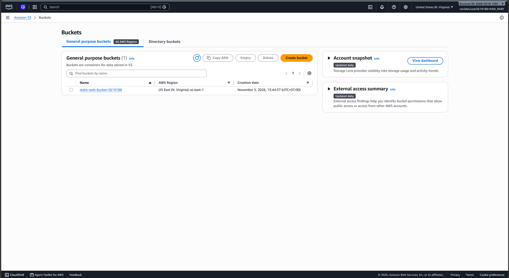
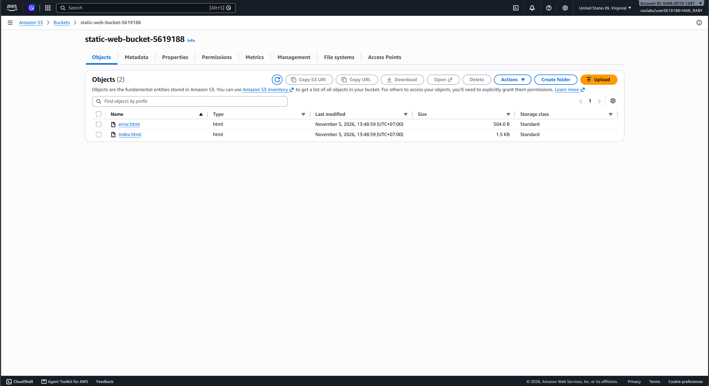
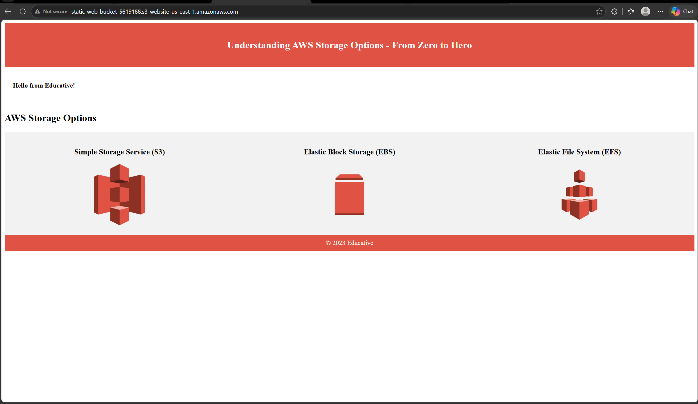
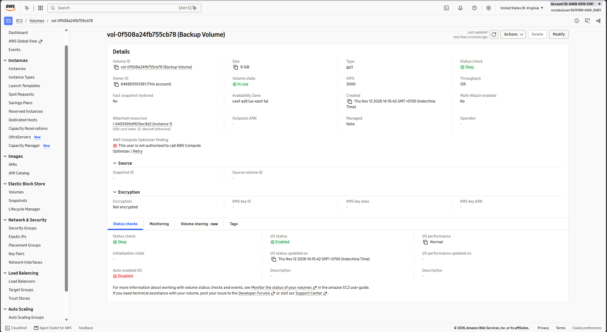
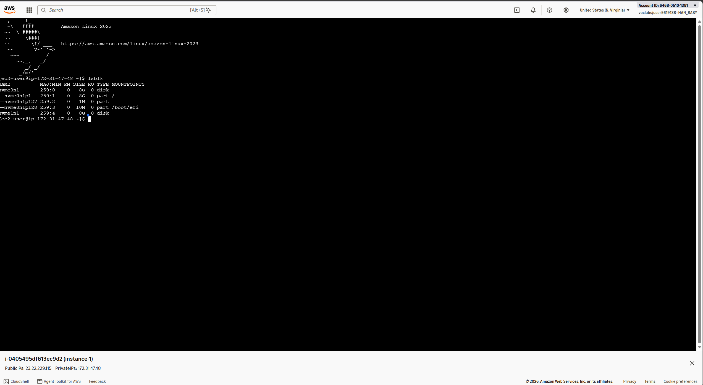
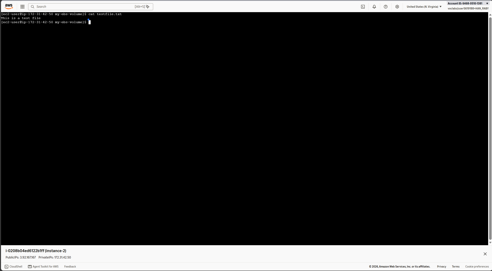
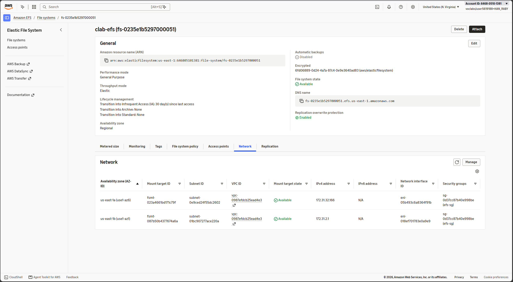
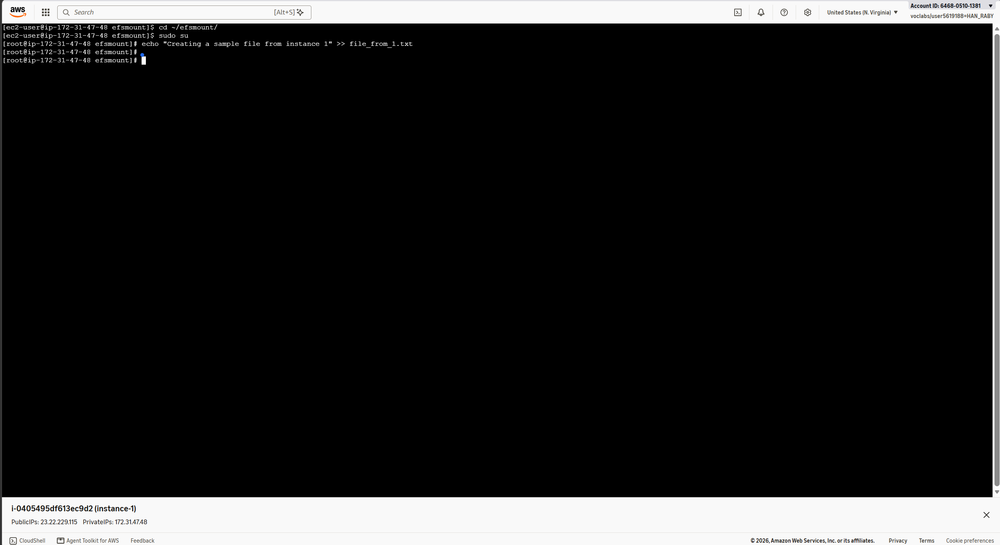
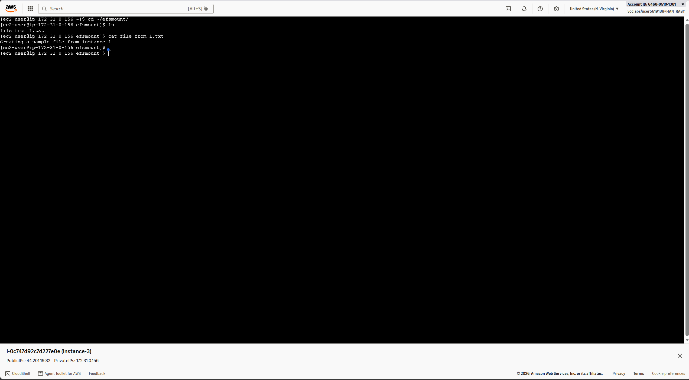

# Cloud Lab 3 Submission — AWS Storage Options

- **Student name: Han Raby**
- **Student ID: e20220580**
- **Learner Lab user name: Han Raby**
- **Date completed: 12 November 2026**

---

## Part 2.1 — Amazon S3

### Bucket list

### Uploaded files

### Static website

---

## Part 2.2 — Amazon EBS

### Volumes page

### Attached volume (`lsblk`)

Which device name did your volume get (`xvdf`, `nvme1n1`, ...)?

### File read on instance-2

---

## Part 2.3 — Amazon EFS

### File system and mount targets

### File created on instance-1

### File listed on instance-3

---

## Questions

1. After you turned on static website hosting, the endpoint first answered **403 Forbidden**. Why, and what changed after you added the bucket policy?

    - The S3 bucket was hosting the website, but the files were not publicly accessible. S3 denied public access, so the website endpoint returned 403 Forbidden.

    - After adding the bucket policy, public users were given permission to read the objects in the bucket. The website could then access and display index.html.

2. `testfile.txt` was still there after you moved **Backup Volume** to `instance-2`. What would have happened to a file saved on `instance-1`'s **root** volume after terminating `instance-1`?

    - testfile.txt stayed because it was stored on the separate Backup EBS Volume, which persisted independently of the instance.

    - A file saved only on instance-1's root volume could be deleted when the instance is terminated, depending on the root volume's Delete on termination setting. In a typical lab setup, the root volume is configured to be deleted with the instance.

3. Why did you run `mkfs` on `instance-1` but not on `instance-2`?

    - mkfs creates a new file system on a volume.
    - On instance-1, the Backup Volume was new and empty, so we needed to create an ext4 file system.
    - On instance-2, the volume already had a file system and contained testfile.txt.
    - Running mkfs again would format the volume and erase its existing data—which is why the instructions said not to run it on instance-2.

4. Why could `instance-1` and `instance-3` use the EFS file system at the same time, when an EBS volume had to be detached first? Why did they have to be in the subnets of the mount targets?

    - EFS is a shared network file system. Multiple EC2 instances can mount and access the same EFS file system simultaneously.
    - In contrast, the EBS volume used in the lab was attached to one instance at a time, so it had to be unmounted and detached before moving it to another instance.
    - The instances needed to be in subnets with EFS mount targets so they could connect to the EFS file system through the network.

5. For each need, choose S3, EBS or EFS and give one reason: (a) a website's images, (b) the disk of a database server, (c) a folder shared by several web servers.

    - (a) A website's images (S3): S3 is designed for storing objects such as images and static website files.
    - (b) The disk of a database server (EBS): 	EBS provides persistent block storage that can be attached to an EC2 instance.
    - (c) A folder shared by several web servers. (EFS): Multiple EC2 instances can mount and access the same shared file system at the same time.

### Problem: 
I accidentally used **Amazon** Linux instead of Ubuntu, which made the commands more complicated than the Ubuntu commands provided in the lab. I solved this by finding and using the equivalent commands for Amazon Linux, such as using yum instead of apt-get. I also adjusted the installation process for the Amazon EFS client so that it could run successfully on my instances.