# Cloud Lab 4 Submission — Amazon VPC

- **Student name: Han Raby**
- **Student ID: e20220580**
- **Learner Lab user name: Han Raby**
- **Date completed: 09 November 2026**

---

## VPC and internet gateway

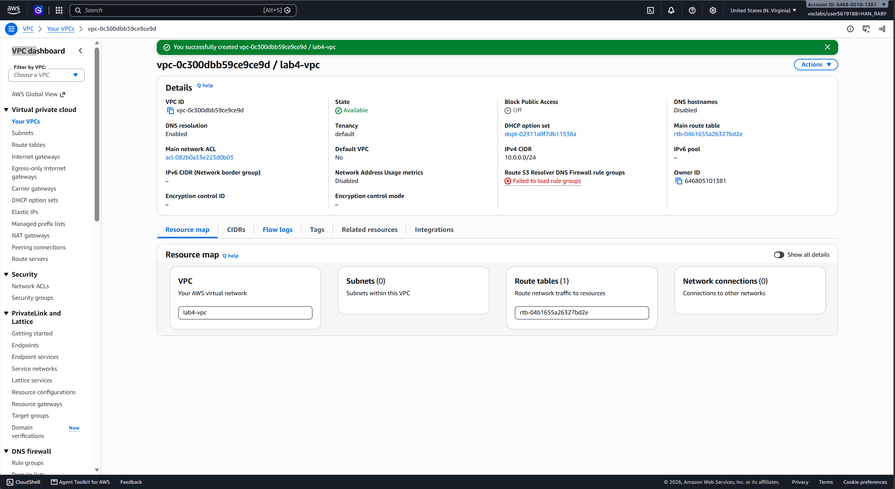

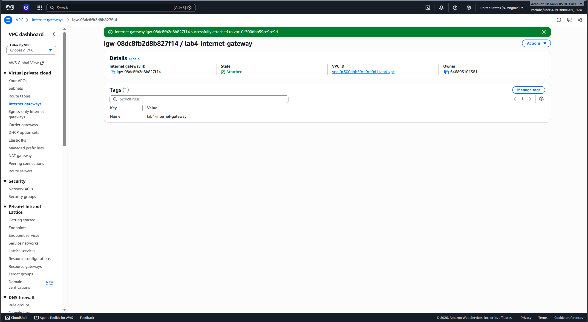

## Public subnet

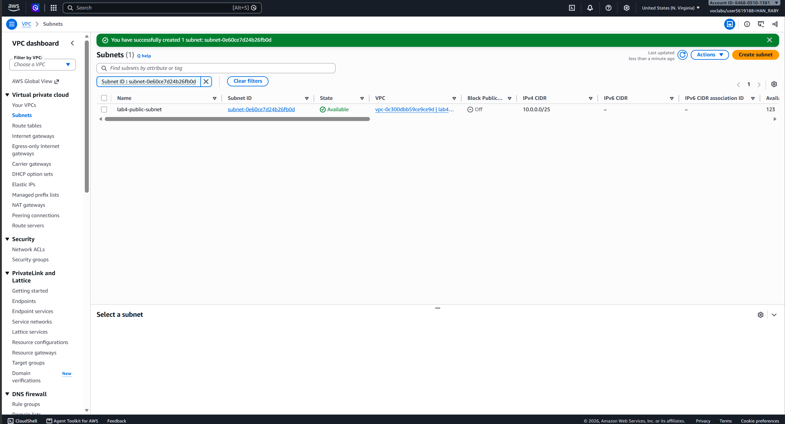

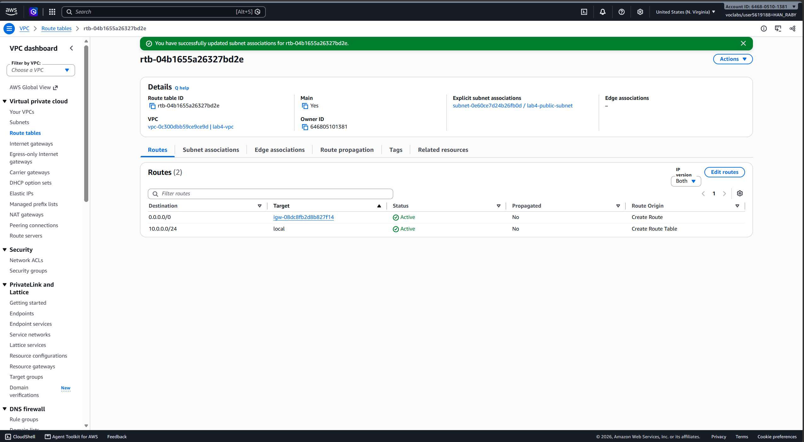

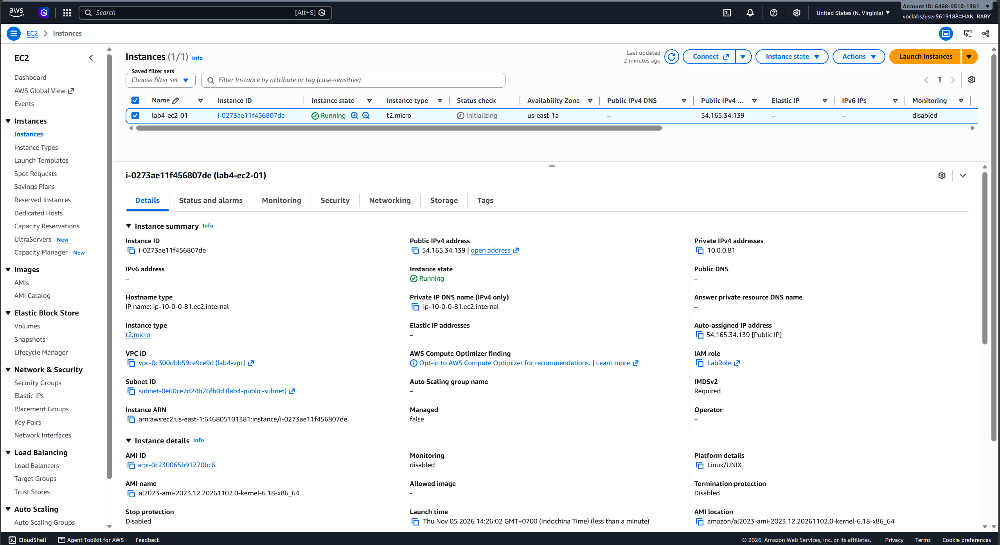

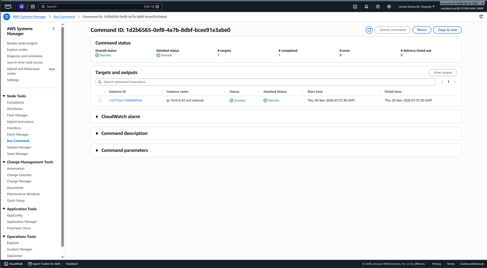

## Private subnet

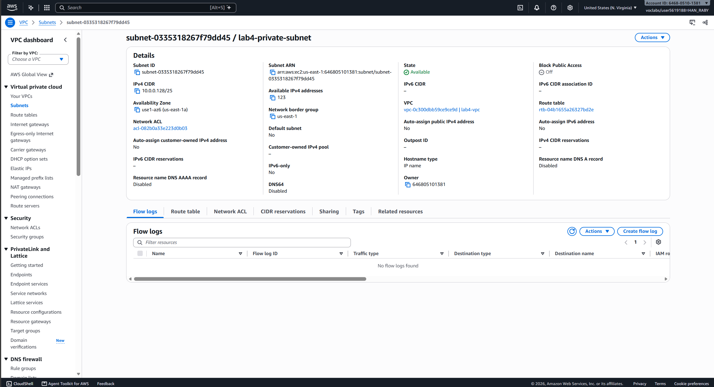

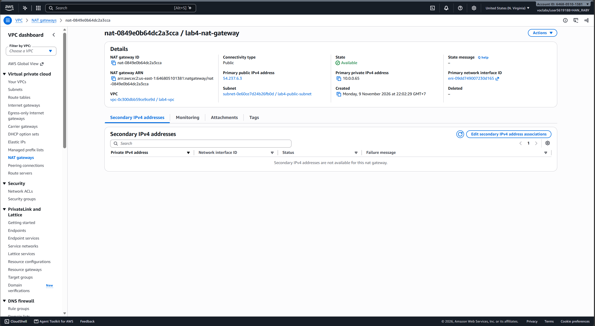

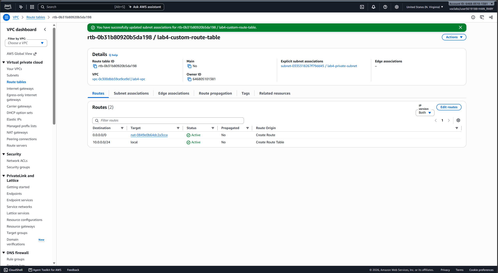

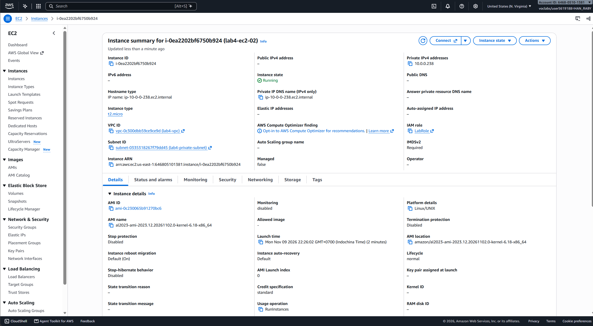

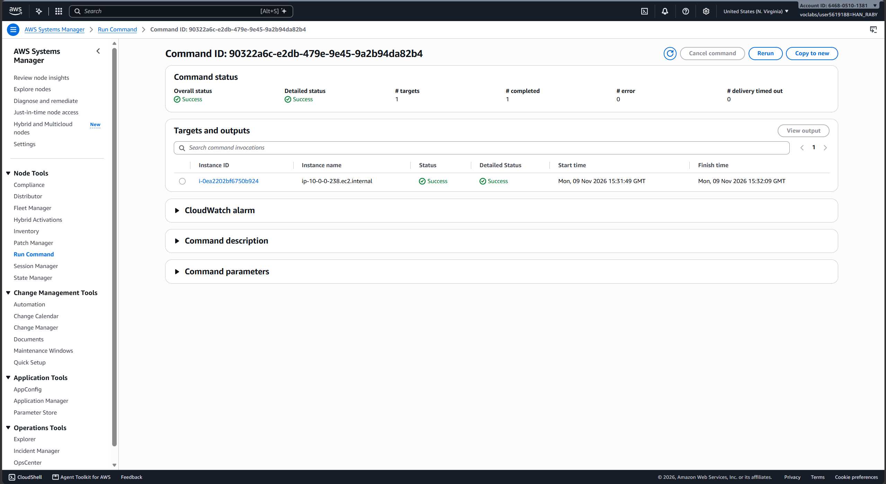

---

## Questions

1. The VPC is `10.0.0.0/24` and the subnets are `10.0.0.0/25` and `10.0.0.128/25`. How many IP addresses does each block contain, and why do the two subnets not overlap?

    => The VPC with CIDR block 10.0.0.0/24 contains 256 IP addresses. Each subnet with a /25 CIDR block contains 128 IP addresses.

    The first subnet, 10.0.0.0/25, covers addresses from 10.0.0.0 to 10.0.0.127. The second subnet, 10.0.0.128/25, covers addresses from 10.0.0.128 to 10.0.0.255. Therefore, the two subnets do not overlap because they use two separate halves of the VPC's address range.

2. Both subnets are in the same VPC. What exactly makes `lab4-public-subnet` public and `lab4-private-subnet` private?

    => A subnet is considered public when its route table has a route to an Internet Gateway. In this lab, lab4-public-subnet has the route 0.0.0.0/0 pointing to the Internet Gateway.

    lab4-private-subnet is private because it does not have a direct route to the Internet Gateway. Instead, its route 0.0.0.0/0 points to the NAT Gateway.

3. Why is the NAT gateway placed in the **public** subnet and not in the private one?

    => The NAT Gateway is placed in the public subnet because it needs access to the Internet Gateway to communicate with the internet. The private EC2 instance sends its outgoing internet traffic to the NAT Gateway, and the NAT Gateway forwards that traffic through the Internet Gateway.

4. `lab4-ec2-02` has no public IP address. Can someone on the internet open a connection to it? Can it download updates? Explain both answers.

    => Someone on the internet cannot directly open a connection to lab4-ec2-02 because it has no public IP address and is located in a private subnet.

    However, it can still download updates. Its outbound traffic is sent through the NAT Gateway in the public subnet, which provides access to the internet. The NAT Gateway allows the private instance to make outbound connections without making the instance directly accessible from the internet.

5. You tested internet access with Systems Manager instead of SSH. Why did the instances need `LabInstanceProfile` for this?

    => The instances needed LabInstanceProfile because it provides the required IAM permissions for AWS Systems Manager to communicate with and manage the EC2 instances. This allowed us to use Systems Manager Run Command without opening an inbound SSH port or connecting directly to the instances.
